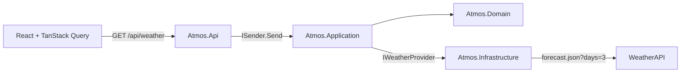

# Atmos

A polished full-stack weather dashboard for Moscow, built with ASP.NET Core and React. It presents current conditions, the remaining hours of today, every hour tomorrow, and a three-day forecast in a responsive single-screen interface.

## Highlights

- Current conditions and useful weather metrics
- Hourly timeline for the rest of today and all of tomorrow
- Three-day forecast with temperature ranges
- Purpose-built loading, failure, and retry experiences
- Moscow-local time handling independent of the host machine and browser time zone
- One server-side WeatherAPI forecast request per cache window
- Automatic five-minute refresh while the page is active
- Clean Architecture with CQRS-style MediatR dispatch
- Provider isolation, resilient HTTP, Problem Details, structured logs, and health checks
- Unit, integration, architecture, component, and end-to-end tests
- Reproducible Docker Compose environment and GitHub Actions CI

## Technology

### Backend

- .NET 10 and C# 14
- ASP.NET Core Web API
- MediatR
- `HttpClientFactory` and the standard .NET resilience handler
- `System.Text.Json` source generation
- xUnit v3 on Microsoft Testing Platform v2, Coverlet.MTP, and NSubstitute

### Frontend

- React 19 and TypeScript
- Vite
- TanStack Query
- Oxlint
- Vitest, Testing Library, and Playwright
- Custom responsive CSS and inline SVG weather artwork

### Delivery

- Multi-stage, non-root containers
- Nginx reverse proxy and static hosting
- Docker Compose
- GitHub Actions and Dependabot

## Quick start with Docker

Requirements:

- Docker with Compose
- A WeatherAPI key

```bash
cp .env.example .env
```

Set `WEATHER_API_KEY` in `.env`, then start the complete application:

```bash
docker compose up --build
```

Open `http://localhost:8088`.

The frontend container serves the built React application and proxies `/api` to the backend. The provider key exists only in the backend process.

## Local development

### Backend

Requirements: the SDK declared in `global.json`.

```bash
export WeatherApi__ApiKey="your-weatherapi-key"
dotnet restore Atmos.slnx
dotnet run --project src/backend/Atmos.Api
```

The API runs at `http://localhost:8080` by default.

Useful endpoints:

```text
GET /api/weather
GET /health
GET /openapi/v1.json
```

### Frontend

Requirements: the Node version declared in `.node-version`.

```bash
cd src/frontend/atmos-web
npm ci
npm run dev
```

Vite runs at `http://localhost:5173` and proxies `/api` and `/health` to the local backend.

## Architecture



The backend projects follow inward dependency rules:

```text
Atmos.Domain          -> no project dependencies
Atmos.Application     -> Atmos.Domain
Atmos.Infrastructure  -> Atmos.Application + Atmos.Domain
Atmos.Api             -> Atmos.Application + Atmos.Infrastructure
```

The application contains one read use case, `GetWeatherQuery`. The API controller has no filtering or provider logic. Infrastructure-specific JSON contracts never leak into the domain or frontend response contract. Architecture tests enforce these dependency rules.

A deeper walkthrough and request sequence are available in [`docs/architecture.md`](docs/architecture.md).

## Important decisions

### One upstream request

`forecast.json?days=3` contains both current conditions and forecast data, so Atmos does not make a redundant `current.json` request.

### No database

There is no state to own or persist. WeatherAPI is the source of truth. A five-minute in-memory cache coalesces repeat requests and limits upstream traffic. Cache entries are capped at the next location-local midnight so a previous day can never survive into a new forecast date.

### Moscow is server-owned configuration

The browser does not request geolocation or submit coordinates. The backend defaults to `55.7558,37.6173`, making the product behavior deterministic and keeping the use case contract input-free.

### Local time drives hour filtering

The server combines its injectable `TimeProvider` clock with the location time-zone identifier returned by the provider. Cached provider timestamps never define "now." At `16:15` Moscow time, the hourly response starts at `17:00` and includes all 24 hours of the next day. At exactly `16:00`, the `16:00` point remains eligible.

## Repository layout

```text
.
├── src
│   ├── backend
│   │   ├── Atmos.Api
│   │   ├── Atmos.Application
│   │   ├── Atmos.Domain
│   │   └── Atmos.Infrastructure
│   └── frontend
│       └── atmos-web
├── tests
│   └── backend
│       ├── Atmos.Api.IntegrationTests
│       ├── Atmos.Application.UnitTests
│       ├── Atmos.ArchitectureTests
│       └── Atmos.Infrastructure.Tests
├── docs
│   └── decisions
├── .github
│   └── workflows
├── docker-compose.yml
└── Atmos.slnx
```

## Verification

Backend:

```bash
dotnet format Atmos.slnx --verify-no-changes
dotnet build Atmos.slnx --configuration Release
dotnet test --solution Atmos.slnx --configuration Release --coverlet --results-directory ./TestResults
```

Frontend:

```bash
cd src/frontend/atmos-web
npm run lint
npm run test:coverage
npm run build
npm run test:e2e
```

Complete container build:

```bash
docker compose build
```

## Configuration

| Setting | Default | Purpose |
| --- | --- | --- |
| `WeatherApi__ApiKey` / `WEATHER_API_KEY` | required | Server-side WeatherAPI credential |
| `WeatherApi__BaseUrl` | `https://api.weatherapi.com/v1/` | Provider base URL |
| `WeatherApi__LocationQuery` | `55.7558,37.6173` | Fixed Moscow coordinates |
| `WeatherApi__ForecastDays` | `3` | Number of provider forecast days |
| `WeatherApi__CacheDuration` | `00:05:00` | Maximum in-memory forecast lifetime; capped at the next location-local midnight |
| `ATMOS_PORT` | `8088` | Host port used by Docker Compose |
| `MEDIATR_LICENSE_KEY` | unset | Optional MediatR license environment variable where required |

Configuration is validated when the API starts. Never commit `.env` or a real provider key.

## Security notes

- The provider API key never enters the browser bundle.
- Provider DTOs and failure details are not returned directly to clients.
- Containers run without root privileges at runtime.
- The frontend sets a restrictive Content Security Policy and related response headers.
- Logs suppress routine `HttpClient` request URLs so credentials in provider query parameters are not emitted at information level.
- Known provider failures are logged without exception objects or upstream request URIs.

## License

MIT
