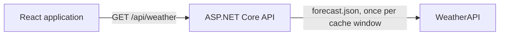
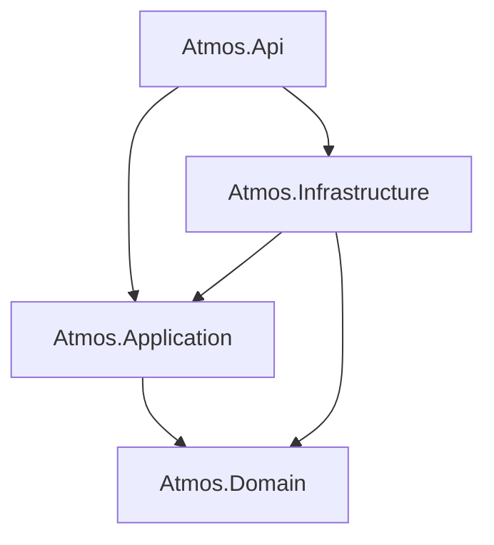
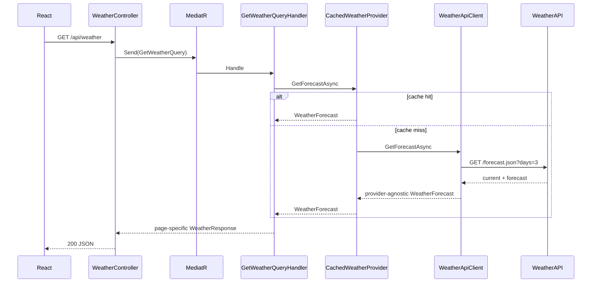

# Architecture

Atmos is a small full-stack product with an intentionally explicit boundary between the user interface, the application use case, the weather domain, and the external provider integration.

## Context

The browser never receives the provider API key and never calls WeatherAPI directly.

## Backend layers

- **Domain** contains provider-agnostic weather models and has no dependency on the other projects.
- **Application** contains the query, handler, response contract, MediatR behavior, and the `IWeatherProvider` port.
- **Infrastructure** implements the port with a named `HttpClient` managed by `IHttpClientFactory`, provider DTOs, mapping, resilience, options validation, and a short-lived cache decorator.
- **API** is the composition root and HTTP boundary. The controller only dispatches the query through MediatR.

Architecture tests enforce the allowed project dependencies.

## Request flow

## Hour selection rule

The provider supplies the location time-zone identifier. The application layer combines that zone with an injectable `TimeProvider`, so cached provider timestamps never define the current time. It returns:

1. Forecast hours from the current Moscow hour onward when the timestamp has not passed.
2. Every forecast hour from the following Moscow calendar day.
3. No hours from the third forecast day.

For example, at `16:15`, the list starts at `17:00`. At exactly `16:00`, the `16:00` forecast is still included. This rule is deterministic and covered by boundary tests.

## Failure model

- Provider transport, timeout, status, malformed JSON, mapping, and unsupported time-zone failures become `WeatherProviderUnavailableException`.
- The API exception handler translates that dependency failure into an RFC 7807-compatible `502` Problem Details response.
- Unexpected failures become a generic `500` response without leaking stack traces or provider details.
- The React query layer renders loading and error states and performs a user-triggered retry without reloading the document.

## Persistence

There is no database. The application is read-only, has no user state, and treats WeatherAPI as the source of truth. A five-minute in-memory cache limits duplicate upstream traffic without inventing persistent data ownership. Its effective lifetime is `min(configured duration, time until the next location-local midnight)`, preventing a previous day's three-day forecast from leaking across the date boundary.

The React query refreshes active weather data every five minutes and also refetches stale data when the window regains focus. Background polling remains disabled while the page is hidden.
